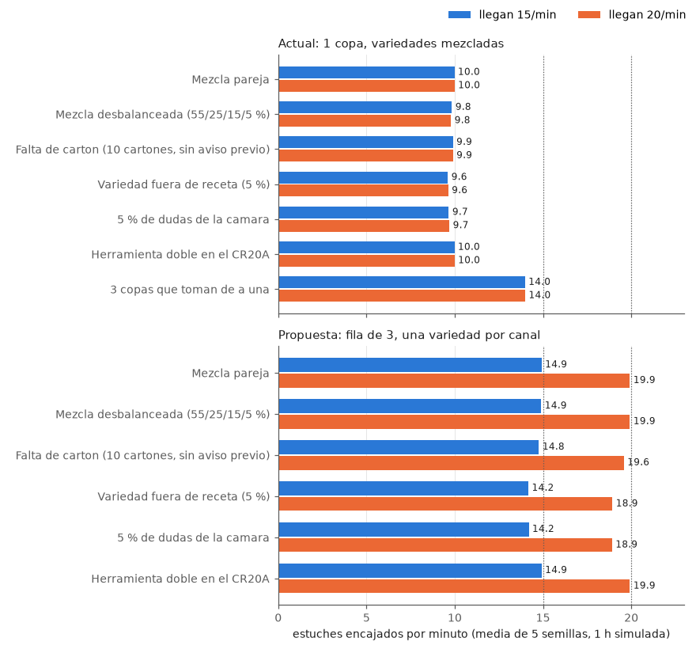

# Modelo de ritmo (eventos discretos)

Generado por `resultados/generar.py`. Media de 5 semillas, 60 min medidos despues de 10 min de arranque. Perdidos, desviados y retenidos: estuches en la hora medida.

| Configuracion | Escenario | Llegan /min | Encajados /min | CR6AL | CR20A | Cola media | Perdidos | Desviados | Retenidos | Sin carton (min) | Cuello de botella |
|---|---|---|---|---|---|---|---|---|---|---|---|
| Actual: 1 copa, variedades mezcladas | Mezcla pareja | 15 | 10.0 | 100 % | 2 % | 36.9 | 300 | 0 | 0 | 0.0 | CR6AL |
| Actual: 1 copa, variedades mezcladas | Mezcla pareja | 20 | 10.0 | 100 % | 2 % | 37.7 | 601 | 0 | 0 | 0.0 | CR6AL |
| Actual: 1 copa, variedades mezcladas | Mezcla desbalanceada (55/25/15/5 %) | 15 | 9.8 | 100 % | 2 % | 37.0 | 309 | 0 | 0 | 0.0 | CR6AL |
| Actual: 1 copa, variedades mezcladas | Mezcla desbalanceada (55/25/15/5 %) | 20 | 9.8 | 100 % | 2 % | 37.8 | 613 | 0 | 0 | 0.0 | CR6AL |
| Actual: 1 copa, variedades mezcladas | Falta de carton (10 cartones, sin aviso previo) | 15 | 9.9 | 99 % | 2 % | 36.9 | 305 | 0 | 0 | 5.0 | CR6AL (y falta de carton) |
| Actual: 1 copa, variedades mezcladas | Falta de carton (10 cartones, sin aviso previo) | 20 | 9.9 | 99 % | 2 % | 37.7 | 606 | 0 | 0 | 5.0 | CR6AL (y falta de carton) |
| Actual: 1 copa, variedades mezcladas | Variedad fuera de receta (5 %) | 15 | 9.6 | 100 % | 2 % | 36.7 | 287 | 34 | 0 | 0.0 | CR6AL |
| Actual: 1 copa, variedades mezcladas | Variedad fuera de receta (5 %) | 20 | 9.6 | 100 % | 2 % | 37.5 | 583 | 35 | 0 | 0.0 | CR6AL |
| Actual: 1 copa, variedades mezcladas | 5 % de dudas de la camara | 15 | 9.7 | 100 % | 2 % | 36.8 | 293 | 29 | 0 | 0.0 | CR6AL |
| Actual: 1 copa, variedades mezcladas | 5 % de dudas de la camara | 20 | 9.7 | 100 % | 2 % | 37.6 | 595 | 28 | 0 | 0.0 | CR6AL |
| Actual: 1 copa, variedades mezcladas | Herramienta doble en el CR20A | 15 | 10.0 | 100 % | 2 % | 36.9 | 300 | 0 | 0 | 0.0 | CR6AL |
| Actual: 1 copa, variedades mezcladas | Herramienta doble en el CR20A | 20 | 10.0 | 100 % | 2 % | 37.7 | 601 | 0 | 0 | 0.0 | CR6AL |
| Actual: 1 copa, variedades mezcladas | 3 copas que toman de a una | 15 | 14.0 | 100 % | 3 % | 27.2 | 45 | 0 | 0 | 0.0 | CR6AL |
| Actual: 1 copa, variedades mezcladas | 3 copas que toman de a una | 20 | 14.0 | 100 % | 3 % | 33.3 | 360 | 0 | 0 | 0.0 | CR6AL |
| Propuesta: fila de 3, una variedad por canal | Mezcla pareja | 15 | 14.9 | 54 % | 3 % | 5.2 | 0 | 0 | 0 | 0.0 | ninguno (sigue el ritmo; el mas cargado es el CR6AL) |
| Propuesta: fila de 3, una variedad por canal | Mezcla pareja | 20 | 19.9 | 72 % | 4 % | 5.7 | 0 | 0 | 0 | 0.0 | ninguno (sigue el ritmo; el mas cargado es el CR6AL) |
| Propuesta: fila de 3, una variedad por canal | Mezcla desbalanceada (55/25/15/5 %) | 15 | 14.9 | 54 % | 3 % | 5.2 | 0 | 0 | 0 | 0.0 | ninguno (sigue el ritmo; el mas cargado es el CR6AL) |
| Propuesta: fila de 3, una variedad por canal | Mezcla desbalanceada (55/25/15/5 %) | 20 | 19.9 | 73 % | 4 % | 5.8 | 0 | 0 | 0 | 0.0 | ninguno (sigue el ritmo; el mas cargado es el CR6AL) |
| Propuesta: fila de 3, una variedad por canal | Falta de carton (10 cartones, sin aviso previo) | 15 | 14.8 | 54 % | 3 % | 5.9 | 9 | 0 | 0 | 5.0 | ninguno (sigue el ritmo; el mas cargado es el CR6AL) |
| Propuesta: fila de 3, una variedad por canal | Falta de carton (10 cartones, sin aviso previo) | 20 | 19.6 | 71 % | 4 % | 7.0 | 20 | 0 | 0 | 5.0 | falta de carton |
| Propuesta: fila de 3, una variedad por canal | Variedad fuera de receta (5 %) | 15 | 14.2 | 57 % | 3 % | 5.4 | 0 | 49 | 0 | 0.0 | ninguno (sigue el ritmo; el mas cargado es el CR6AL) |
| Propuesta: fila de 3, una variedad por canal | Variedad fuera de receta (5 %) | 20 | 18.9 | 75 % | 4 % | 6.0 | 0 | 63 | 0 | 0.0 | ninguno (sigue el ritmo; el mas cargado es el CR6AL) |
| Propuesta: fila de 3, una variedad por canal | 5 % de dudas de la camara | 15 | 14.2 | 57 % | 3 % | 5.3 | 0 | 47 | 0 | 0.0 | ninguno (sigue el ritmo; el mas cargado es el CR6AL) |
| Propuesta: fila de 3, una variedad por canal | 5 % de dudas de la camara | 20 | 18.9 | 75 % | 4 % | 5.9 | 0 | 61 | 0 | 0.0 | ninguno (sigue el ritmo; el mas cargado es el CR6AL) |
| Propuesta: fila de 3, una variedad por canal | Herramienta doble en el CR20A | 15 | 14.9 | 54 % | 3 % | 5.2 | 0 | 0 | 0 | 0.0 | ninguno (sigue el ritmo; el mas cargado es el CR6AL) |
| Propuesta: fila de 3, una variedad por canal | Herramienta doble en el CR20A | 20 | 19.9 | 72 % | 4 % | 5.7 | 0 | 0 | 0 | 0.0 | ninguno (sigue el ritmo; el mas cargado es el CR6AL) |

