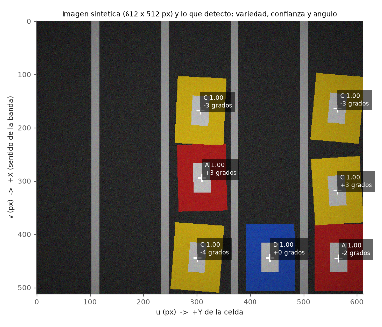

# Vision: matriz de confusion con imagenes sinteticas

Generado por `resultados/generar.py`. 40 imagenes por condicion, 612 x 512 px (resolucion real / 4, 1.04 mm/px). Filas: verdad; columnas: lo que dijo la vision. 'X violeta' e 'Y naranja' estan fuera de receta (el naranja queda entre las variedades A y C).

## Luz normal

Brillo 0.6-1.3, ruido 0.01-0.04, tinte +/-7 %, viñeteo 0.0-0.25.

| Verdad | A | B | C | D | desconocida | duda | no detectado |
|---|---|---|---|---|---|---|---|
| A | 57 | 0 | 0 | 0 | 0 | 0 | 0 |
| B | 0 | 62 | 0 | 0 | 0 | 0 | 0 |
| C | 0 | 0 | 56 | 0 | 0 | 0 | 0 |
| D | 0 | 0 | 0 | 60 | 0 | 0 | 0 |
| X violeta | 0 | 0 | 0 | 0 | 32 | 0 | 0 |
| Y naranja | 0 | 0 | 0 | 0 | 24 | 0 | 0 |

Detecciones sin estuche real: 0. Error de posicion de los aciertos: medio 0.8 mm, maximo 4.0 mm. Error de angulo maximo 6.2 grados.

## Luz dificil

Brillo 0.3-1.6, ruido 0.03-0.09, tinte +/-18 %, viñeteo 0.1-0.45.

| Verdad | A | B | C | D | desconocida | duda | no detectado |
|---|---|---|---|---|---|---|---|
| A | 56 | 0 | 0 | 0 | 0 | 1 | 0 |
| B | 0 | 55 | 0 | 0 | 0 | 4 | 3 |
| C | 0 | 0 | 44 | 0 | 0 | 12 | 0 |
| D | 0 | 0 | 0 | 59 | 0 | 1 | 0 |
| X violeta | 0 | 0 | 0 | 0 | 30 | 1 | 1 |
| Y naranja | 0 | 0 | 0 | 0 | 12 | 12 | 0 |

Detecciones sin estuche real: 1. Error de posicion de los aciertos: medio 1.1 mm, maximo 13.3 mm. Error de angulo maximo 21.7 grados.

